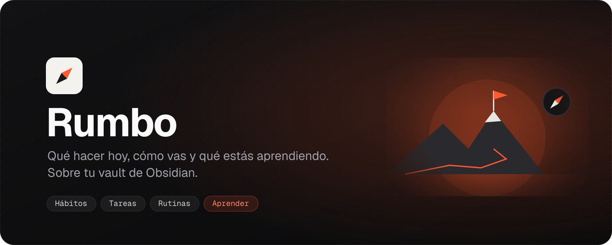
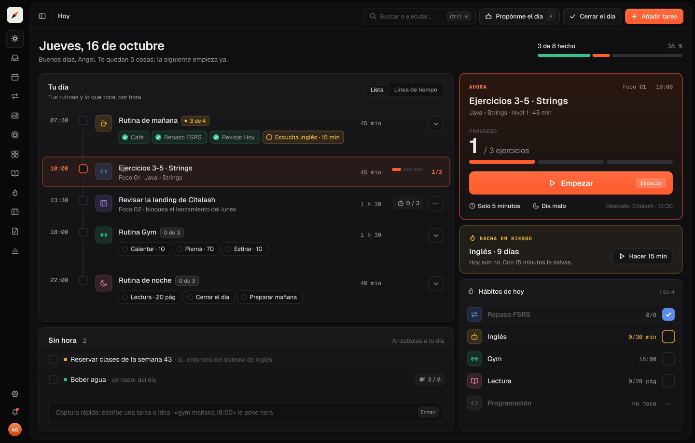
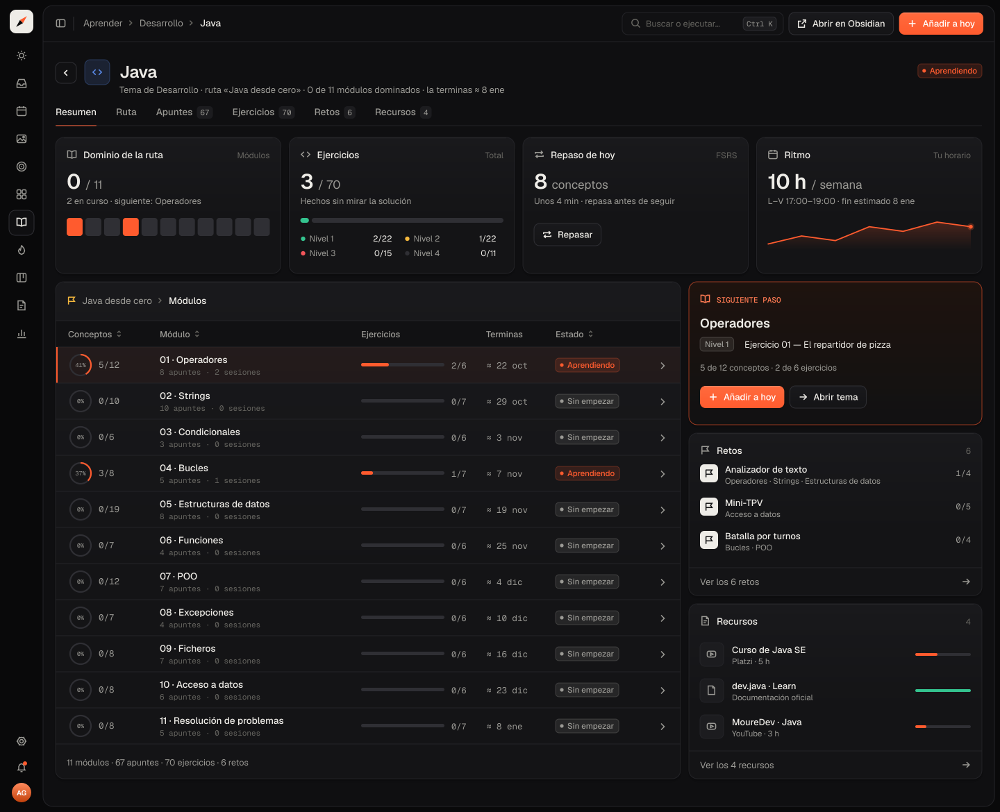
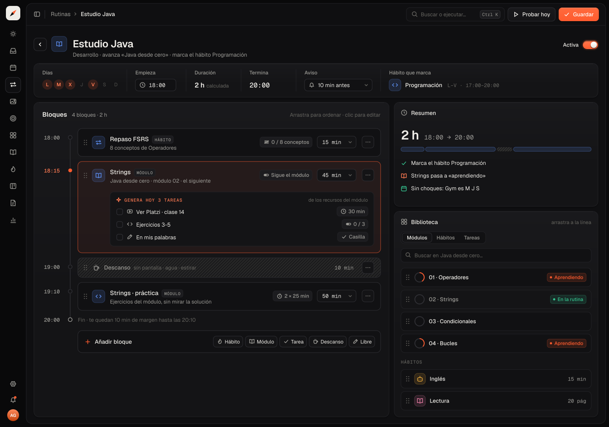
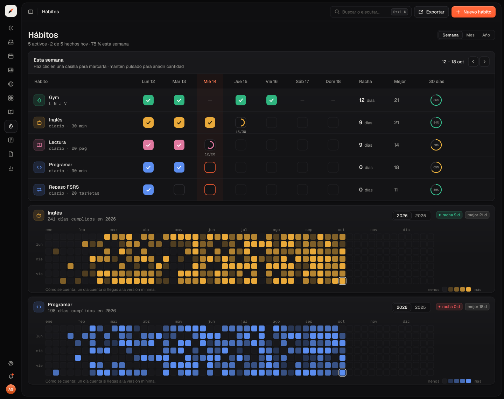
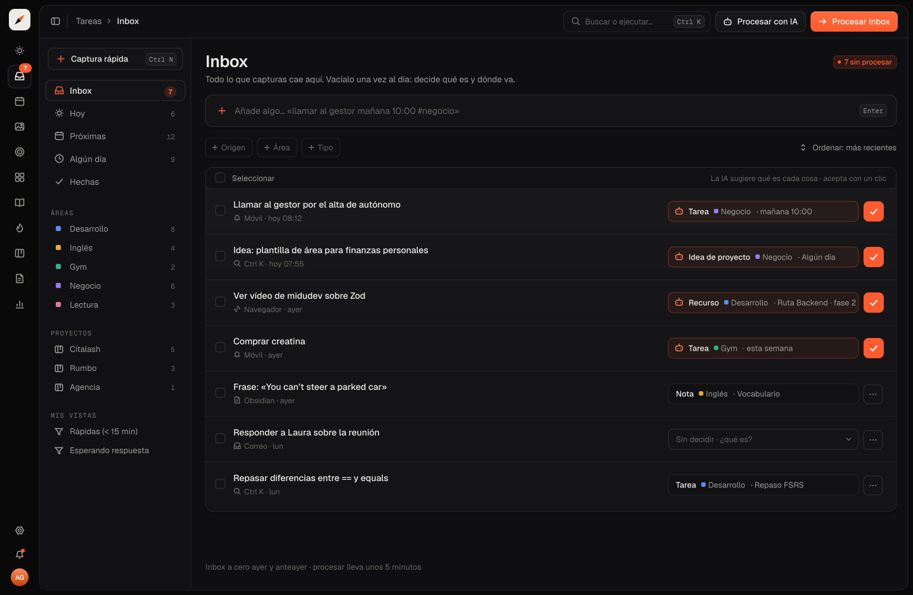

<p align="center">
  
</p>

<p align="center">
  <a href="https://github.com/angelgmx/rumbo/actions/workflows/ci.yml"></a>
  
  
  
  
  
</p>

<p align="center">
  <b>Una app de escritorio que te dice qué hacer hoy, cómo vas y qué estás aprendiendo,<br>leyendo y escribiendo tu vault de Obsidian.</b>
</p>

---

<p align="center">
  
</p>

## Por qué existe

Tenía objetivos claros y notas por todas partes, pero ningún sitio que me dijera **qué toca ahora**. Rumbo junta tu día, tus hábitos, tus tareas y lo que estás aprendiendo en una sola pantalla, sin sacar tus datos de Obsidian.

- **Tus notas siguen siendo tuyas.** Todo es Markdown con frontmatter. Si borras la app, Obsidian lo sigue leyendo todo.
- **Sencilla, sin abrumar.** Cada pantalla responde a una sola pregunta.
- **Arrancar cuesta poco.** Un botón _Empezar_, modo _solo 5 minutos_ y un _día malo_ que no rompe la racha.
- **La IA propone, tú decides.** Nada se escribe sin una vista previa que aceptes.

## Qué hace

| Pestaña                          | Para qué                                                          | Estado   |
| -------------------------------- | ----------------------------------------------------------------- | -------- |
| **Hoy**                          | Tu día por horas, lo que toca ahora y tus hábitos                 | Hecho    |
| **Tareas**                       | Inbox, Hoy, Próximas, vistas guardadas y captura rápida           | Hecho    |
| **Hábitos**                      | Rachas, tracker semanal y el año en un mapa de calor              | Hecho    |
| **Aprender**                     | Rutas, temas, ejercicios, retos, recursos y repaso espaciado      | Hecho    |
| **Rutinas**                      | Bloques que unen hábitos, temas y tareas a una hora               | En curso |
| **Calendario**                   | Tu semana con rutinas, hábitos y bloques                          | Roadmap  |
| **Notas**                        | Leer y editar tus notas, búsqueda con `Ctrl K`                    | Roadmap  |
| **Áreas, Objetivos y Proyectos** | Hacia dónde vas y si llegas a tiempo                              | Roadmap  |
| **IA**                           | Crear rutas, proponer el día, corregir ejercicios, delegar tareas | Roadmap  |
| **Métricas y coach**             | Pocas métricas, todas llevan a una acción                         | Roadmap  |

Lo que falta, fase a fase, en el [roadmap](docs/roadmap.md).

<table>
  <tr>
    <td></td>
    <td></td>
  </tr>
  <tr>
    <td align="center"><sub>Aprender · tema con su ruta, ejercicios y repaso</sub></td>
    <td align="center"><sub>Rutinas · cada bloque marca un hábito o avanza un tema</sub></td>
  </tr>
  <tr>
    <td></td>
    <td></td>
  </tr>
  <tr>
    <td align="center"><sub>Hábitos · rachas y año completo</sub></td>
    <td align="center"><sub>Tareas · inbox y vistas</sub></td>
  </tr>
</table>

Todas las pantallas, ordenadas por pestaña, en [`docs/design`](docs/design/).

## Cómo funciona

```
Objetivo ──► Hábito ──► Rutina ──► Tareas de hoy ──► hechas
   ▲                       │
   └── Ruta ◄── Tema ◄─────┘   sube el módulo, la ruta y el objetivo
```

Rumbo lee tu vault, entiende cada nota por su `type:` en el frontmatter y calcula al vuelo lo que no hace falta guardar: rachas, progreso, fechas estimadas. El formato está documentado en [`docs/formato-del-vault.md`](docs/formato-del-vault.md).

## Tecnología

| Capa       | Qué usa                                                                                |
| ---------- | -------------------------------------------------------------------------------------- |
| Escritorio | Tauri 2 (Rust), permisos solo a la carpeta del vault                                   |
| Interfaz   | React 19, Vite, Tailwind 4, shadcn/ui, Motion, React Flow                              |
| Lógica     | `@rumbo/core`: TypeScript puro, sin UI ni Tauri, con puertos para el disco y el reloj  |
| Calidad    | TypeScript estricto, Oxlint, Oxfmt, Vitest, Lefthook, commitlint, CI en GitHub Actions |

```
rumbo/
├── apps/desktop       app de escritorio (Tauri + React)
├── packages/core      dominio, lectura del vault y servicios
├── examples/          vault de ejemplo para tests y capturas
└── docs/              arquitectura, formato, decisiones y diseño
```

Más detalle en [`docs/arquitectura.md`](docs/arquitectura.md) y las decisiones en [`docs/adr`](docs/adr/).

## Probarla

Necesitas Node 24, pnpm 11 y Rust (ver [requisitos](docs/desarrollo.md#requisitos)).

```bash
git clone https://github.com/angelgmx/rumbo.git
cd rumbo
pnpm install
pnpm dev
```

Al abrirla, elige tu vault o crea uno nuevo. Para probar sin tocar tus notas, abre `examples/demo-vault`.

## Licencia y contribuciones

El código es **visible pero con todos los derechos reservados**. Puedes leerlo, compilarlo y usar la app sin modificarla para uso personal. **No se permite modificarla, redistribuirla ni enviar cambios sin mi permiso.** Los issues están abiertos para errores e ideas.

Detalles en [`LICENSE`](LICENSE) y [`CONTRIBUTING.md`](CONTRIBUTING.md).

---

<p align="center"><sub>Hecho por <a href="https://github.com/angelgmx">Angel Gómez</a>.</sub></p>
