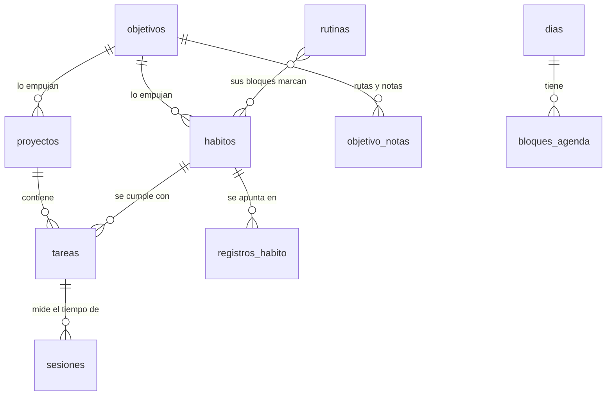

# Modelo de datos

Rumbo guarda cada cosa donde mejor se cuida (ver [ADR-0013](adr/0013-organizacion-en-sqlite-conocimiento-en-el-vault.md)):

| Dónde                      | Qué                                                                                                | Por qué                                                           |
| -------------------------- | -------------------------------------------------------------------------------------------------- | ----------------------------------------------------------------- |
| **Vault** (Markdown)       | El conocimiento: áreas, temas, rutas, módulos, apuntes, ejercicios, retos, recursos y el diario    | Es tuyo, se lee en Obsidian y dura décadas                        |
| **Base de datos** (SQLite) | La organización: tareas, hábitos, rutinas, objetivos, proyectos, sesiones, cierres del día e ideas | Necesita consultas rápidas, relaciones y que nunca quede a medias |

La base de datos es un fichero `rumbo.db` en la carpeta de datos de la app (no en el vault): así Obsidian Sync no la toca y no puede corromperse al sincronizar desde dos equipos.

## Reglas

- **Nombres en castellano**: tablas en plural (`tareas`), columnas en minúscula con guion bajo (`fecha_limite`). Quien abra el fichero entiende qué guarda.
- **Fechas** como texto `AAAA-MM-DD`; **horas** como `HH:MM`; **momentos** como ISO (`2026-10-16T10:30:00Z`).
- **Sí / no** como `0` o `1`.
- **Enlaces al vault** por el nombre de la nota (`area`, `modulo`, `ruta_nota`): el conocimiento sigue en el vault y la base de datos solo lo señala. **Entre tablas, por id** (`objetivo_id`, `proyecto_id`).
- **Una fila, una escritura.** Lo que pertenece a una sola cosa y siempre se guarda con ella (los pasos y las etiquetas de una tarea) va en columnas JSON validadas con `json_valid`: así cada cambio es una sola sentencia y nunca queda a medias.
- **Lo que se calcula no se guarda**: rachas, porcentajes y progreso se calculan al leer.
- **El esquema va por versiones** (`PRAGMA user_version`). Una versión publicada no se cambia; cada cambio es una versión nueva.
- **Borrar** quita la fila y sus hijas (pasos, registros, bloques) con `ON DELETE CASCADE`. Nada del vault se borra desde la base de datos.

## Diagrama

Las rutas, módulos y áreas no salen en el diagrama porque viven en el vault: las tablas las señalan con `*_nota`.

## Tablas

Estado: ✅ ya en la base de datos · ⏳ todavía en el vault, pasa en su migración.

| Tabla              | Qué guarda                                                                                               | Columnas principales                                                                                                                                                                                                                                                                                                                                              | Estado |
| ------------------ | -------------------------------------------------------------------------------------------------------- | ----------------------------------------------------------------------------------------------------------------------------------------------------------------------------------------------------------------------------------------------------------------------------------------------------------------------------------------------------------------- | ------ |
| `ajustes`          | Ajustes internos (qué se importó ya del vault)                                                           | `clave`, `valor`                                                                                                                                                                                                                                                                                                                                                  | ✅     |
| `ideas`            | Lo que se te ocurre y aún no es una tarea                                                                | `id`, `texto`, `creada`                                                                                                                                                                                                                                                                                                                                           | ✅     |
| `tareas`           | Lo que hay que hacer, en una sola fila: así nunca queda a medias                                         | `id`, `titulo`, `estado` (pendiente · en_curso · hecha · cancelada), `notas`, `pasos` (JSON), `etiquetas` (JSON), `prioridad`, `programada`, `vence`, `repeticion`, `duracion_min`, `minutos_trabajados`, `area`, `proyecto_id`, `modulo`, `habito`, `en_foco_el`, `archivada`, `creada`, `hecha_el`                                                              | ✅     |
| `habitos`          | Lo que quieres hacer con constancia                                                                      | `id`, `clave` (fija), `nombre`, `tipo` (si_no · cantidad · duracion · tareas), `meta`, `minimo`, `unidad`, `frecuencia` (JSON: "diaria", ["lun", "mie"] o {"veces_por_semana": 3}), `area`, `objetivo_id`, `icono`, `color`, `hora_inicio`, `hora_fin`, `empezado`, `hasta`, `archivado`, `creado`                                                                | ✅     |
| `registros_habito` | Lo que hiciste de un hábito cada día (solo los días con algo; en los de sí o no, 1)                      | `habito_id`, `dia`, `valor`                                                                                                                                                                                                                                                                                                                                       | ✅     |
| `dias`             | El cierre de cada día                                                                                    | `dia`, `energia` (baja · media · alta), `dia_malo`, `lo_que_salio_bien`                                                                                                                                                                                                                                                                                           | ⏳     |
| `bloques_agenda`   | Bloques con hora de un día                                                                               | `id`, `dia`, `inicio`, `fin`, `texto`, `hecho`                                                                                                                                                                                                                                                                                                                    | ⏳     |
| `rutinas`          | Lo que haces cada día a una hora, con sus bloques en orden dentro (JSON)                                 | `id`, `nombre`, `tipo` (manana · tarde · noche · estudio · gym · libre), `dias` (JSON), `hora_inicio`, `area`, `activa`, `bloques` (JSON: `tipo` habito · tema · tarea · descanso · libre, `minutos`, `titulo`, `habito`, `tema`), `creada`                                                                                                                       | ✅     |
| `objetivos`        | Un resultado que quieres en una fecha, con sus resultados clave, planes «si… entonces» y recursos dentro | `id`, `titulo`, `area`, `por_que`, `horizonte` (anio · trimestre), `periodo`, `fecha_limite`, `estado` (sin_empezar · activo · pausado · hecho · abandonado · fallido), `resultados_clave` (JSON: `nombre`, `desde`, `hasta`, `unidad`, `actual`), `obstaculo`, `planes` (JSON: `si`, `entonces`), `recursos` (JSON: `titulo`, `url`, `tipo`, `fuente`), `creado` | ✅     |
| `objetivo_notas`   | Las notas del vault de un objetivo: las rutas que lo empujan y las notas que lo acompañan                | `objetivo_id`, `nota`, `tipo` (ruta · nota)                                                                                                                                                                                                                                                                                                                       | ✅     |
| `proyectos`        | Lo que estás construyendo, con sus hitos y enlaces dentro                                                | `id`, `titulo`, `resultado`, `area`, `objetivo_id`, `estado` (idea · en_marcha · bloqueado · hecho), `inicio`, `fecha_limite`, `terminado`, `enlaces` (JSON: `titulo`, `url`), `hitos` (JSON: `titulo`, `fecha`, `hecho`), `archivado`, `creado`                                                                                                                  | ✅     |
| `sesiones`         | El tiempo de verdad que trabajaste                                                                       | `id`, `inicio`, `fin`, `minutos`, `tipo` (trabajo · descanso), `tarea_id`, `modulo_nota`                                                                                                                                                                                                                                                                          | ⏳     |
| `vistas_guardadas` | Filtros de Tareas que guardas                                                                            | `id`, `nombre`, `vista`, `filtros`                                                                                                                                                                                                                                                                                                                                | ⏳     |
| `propuestas_ia`    | Lo que propuso la IA y qué decidiste                                                                     | `id`, `tipo`, `contenido`, `estado` (pendiente · aceptada · parcial · rechazada), `creada`, `decidida`, `cambios`                                                                                                                                                                                                                                                 | ⏳     |

## Enlaces de antes

Hasta la versión 6, `habitos.objetivo` y `tareas.proyecto` guardaban el nombre de la nota del objetivo o del proyecto. Al importar esas notas se enlazan por id (`objetivo_id`, `proyecto_id`) y el nombre se vacía. La app ya no los lee ni los escribe.

## Cómo entra lo que ya tenías

Al abrir, Rumbo copia a la base de datos lo que antes vivía en notas, **una sola vez por cosa** (lo apunta en `ajustes`, `importado.<cosa>`). Las notas no se tocan: siguen en el vault.

| Cosa      | De dónde se importa                                                                                                    | Estado |
| --------- | ---------------------------------------------------------------------------------------------------------------------- | ------ |
| Ideas     | La nota de ideas (`folders.ideas`), una viñeta por idea                                                                | ✅     |
| Tareas    | Las casillas del inbox, de las dailies (las de «Foco de hoy», en el foco de su día) y de las notas de proyecto         | ✅     |
| Hábitos   | Las notas `type: habit` y el campo `habits:` de cada daily (lo que no se hizo no se copia)                             | ✅     |
| Rutinas   | Las notas `type: routine`, con los bloques de hábito pasados a su clave                                                | ✅     |
| Objetivos | Las notas `type: goal`; las rutas con `goal:` pasan a `objetivo_notas`                                                 | ✅     |
| Proyectos | Las notas `type: project` (en pausa → bloqueado; abandonado → archivado); sus casillas entran como tareas del proyecto | ✅     |

## En el código

- `packages/core/src/ports.ts`: el puerto `Database` (`execute` y `select`, parámetros con `?`).
- `packages/core/src/db/`: el esquema (`migrations.ts`), `AppDatabase` (abre, migra y avisa a la UI) y un repositorio por tabla. Las consultas traducen las columnas al inglés del código con `AS`.
- `apps/desktop/src/platform/sqliteDatabase.ts`: el puerto sobre el plugin `sql` de Tauri.
- Los tests usan `node:sqlite` en memoria: la misma SQL que la app.
